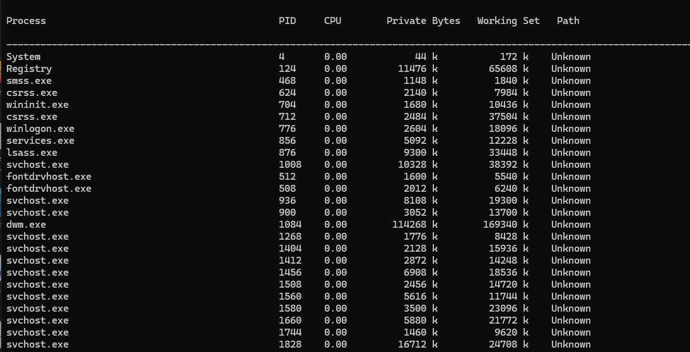
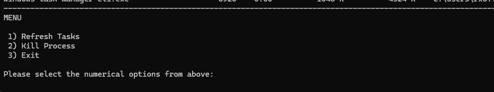

# windows-task-manager-cli

 

Ever wanted a command line based Task Manager for Windows? Well, me neither! The windows-task-manager-cli was created as a project to help me with learning Windows System programming 
and to refresh skills with C/C++ in a Windows environment. The columns, data, and functionality that were added to this project closely resembles that of the Process Explorer tool 
which can be found in the Windows Sysinternals Suite. 

 

All running process image executables can be viewed along with their PIDs. All columns presented in the interface are shown below:

 

At the bottom of all the displayed tasks, there's a text-based menu with the following options:

1. Refresh Tasks
2. Kill Process
3. Exit

 

Enter the number for the corresponding option you'd like to choose. Entering  1 will update all process information and re-render the output. Selecting 2 will then prompr the user
for a PID to select for termination. It should be noted that the user will need to have the proper privileges (PROCESS_TERMINATE) granted in order to successfully terminate the target process.
Finally, option 3 will exit the application.

> Note: When terminating a task, the Win32 `TerminateProcess` API is used. This will abruptly terminate the task. Because of this, no attached DLLs of the process will be notified
of the termination. `DLL_PROCESS_DETACH` will be bypassed and any cleanup routines and/or globally saved state will not occur. 
 
Upon successfully terminating a target process, a message confirming the action along with the PID will be displayed before refreshing the text-based task manager:

